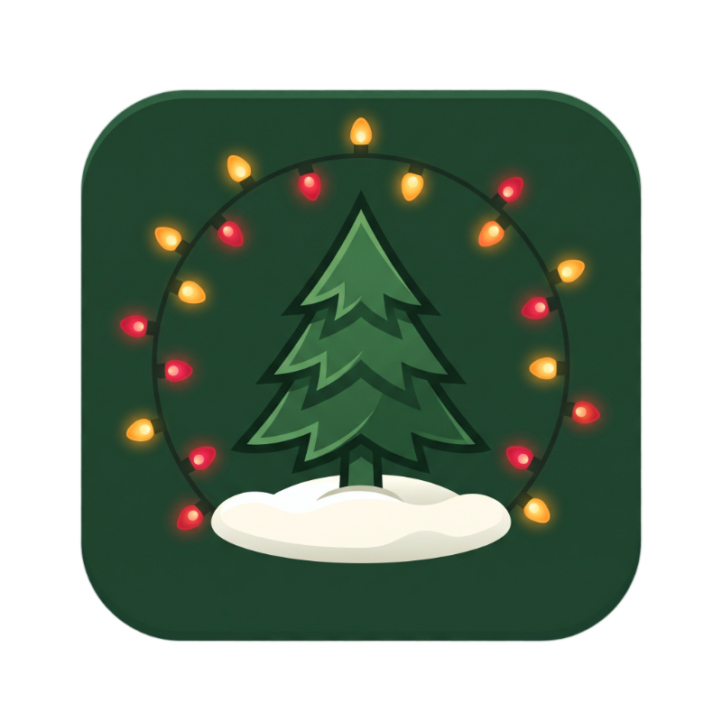

# 현빗 윈터 — 원본 기반 한글 수정본 0.2.1

Wintermas 원작 amiayweb: https://github.com/amiayweb/Wintermas

첨부 원본을 새 기준으로 한글 UI, 가로형 설정창, 클릭 없이 눈 쓸기만 추가했습니다.
원본의 적설 렌더러·눈덩이 성장/물리·제설차·산타·장식을 유지합니다.
원본 LICENSE(PolyForm Noncommercial 1.0.0)를 따릅니다.

## Windows 실행
프로젝트 폴더에서 다음을 실행하세요. Node.js 및 원본의 Windows 빌드 도구가 필요합니다.
```powershell
npm.cmd ci
npm.cmd exec -- install-electron
npm.cmd start
```
설정은 880×460 범위의 가로형이며, 작은 화면은 스크롤로 확인할 수 있습니다.
겨울 모드와 눈 내리기를 켜고 눈이 쌓이면 클릭하지 않은 채 마우스로 쓸어보세요.
클릭 후 굴려 눈덩이를 만드는 조작은 원본 그대로입니다.

## 확인 범위
쓸기 기능 2개 테스트, 전체 JS 문법 검사, 원본 눈 관련 파일 및 LICENSE 동일성 검사 통과.
실제 Windows 외관·동작과 EXE 빌드는 이 환경에서 검증하지 못했습니다.
이전 0.4.x 수정본의 눈 디자인/물리 변경은 포함하지 않았습니다.

---

<p align="center">
  
</p>

<h1 align="center">Wintermas</h1>

<p align="center">An interactive Christmas desktop widget for Windows.</p>

<p align="center">
  
  
  
</p>

Wintermas brings snowfall and Christmas decorations to your existing desktop. Snow settles on window edges and can spill when you move or resize a window. The widget controls the effects and can be tucked away in the Windows system tray.

## Demo

[](./demo/demo.mp4)

[Watch or download the 47-second demo (MP4)](./demo/demo.mp4)

## Install

1. Get **Wintermas-Setup.exe** from [Releases](../../releases) when a build is available, or [build the installer](#build-from-source) locally.
2. Run the installer, choose a folder and select **Open Wintermas** when it finishes.
3. Click the widget and turn on **Christmas mode**, then **Snowfall**.

The installer targets Windows x64 and uses Microsoft Edge WebView2 for its interface. It installs for your Windows account. You can remove Wintermas through **Settings → Apps → Installed apps**.

## What you can do

| Feature | How to use it |
| --- | --- |
| Snowfall | Adjust **Intensity** and **Wind** in the widget. Snow can collect on open windows. **Snow on the taskbar** is on by default and has its own toggle. |
| Snowballs and snowmen | Use **Make snowball**, or click and drag across a snowbank to roll a ball. Drag and release a ball to throw it. Stack three snowballs to make a snowman. |
| Santa and gifts | Select **Send Santa** to watch the sleigh fly across the desktop and drop gifts. |
| Snowplow | Select **Snowplow** to clear snow along the taskbar. Use **Reset snow** to clear accumulated snow. |
| Garlands | Choose a light palette or custom color, then select **Hang garland**. Click to place the first anchor, use **Ctrl + click** to add anchors, and click to finish. |
| Christmas trees | Select **Place tree**, then click where you want it. **Clear decorations** removes the decorations you placed. |
| System tray | Drag the widget by its handle. Select **Hide to system tray** to tuck it away, double-click the tray icon to bring it back, or use its menu to quit. |

**Shortcut.** Press **Alt + Shift + B** over a snowbank to gather snow into a ball.

## Build from source

Build on Windows x64 with Node.js 22.12 or later, npm and the .NET Framework 4.x C# compiler. The installer build uses Windows PowerShell, `curl.exe` and `tar.exe` and downloads the pinned WebView2 SDK from NuGet. To use a local copy of that SDK, set `WINTERMAS_WEBVIEW2_SDK` to the path of its `.nupkg` file.

```powershell
npm.cmd ci
npm.cmd exec -- install-electron
npm.cmd start
```

To package the app and build its installer:

```powershell
npm.cmd run build
```

The build writes `dist/setup/Wintermas-Setup.exe`. Keep the generated `dist` folder out of Git.

## Release a new version

Update the version with `npm version patch --no-git-tag-version` (or choose `minor` or `major`). Update the version shown in the local badge at `.github/version.svg` and its alt text in this README, then commit and push to `main`. GitHub Actions skips versions with an existing `vX.Y.Z` tag. For a new version, it builds the installer and publishes it in a GitHub Release with a tag pointing to the built commit.

## Project layout

| Path | Purpose |
| --- | --- |
| `main.js`, `preload.cjs` | Electron windows, settings, system tray and communication with the interface |
| `ui/` | Widget interface, desktop overlay, snow effects and decoration artwork |
| `native/` | Windows helper that tracks window and taskbar geometry |
| `setup/`, `scripts/` | WebView2 installer interface and build scripts |
| `demo/` | Desktop demo video and preview image |

## License

Copyright © amiayweb.

Wintermas source code is available under the [PolyForm Noncommercial License 1.0.0](./LICENSE). You may use, modify, and share the software for permitted noncommercial purposes under the terms of the license. Commercial use requires separate permission from amiayweb.

## Acknowledgments

Wintermas was inspired by [KoiArt](https://koiart.app/), a desktop effects app for macOS.


## 0.1.2 — 창 이동과 얕은 눈 처마
- 창을 옮기면 이동 속도/방향에 따라 눈이 불규칙한 덩어리로 흩어집니다.
- 원본 눈의 질감을 유지하면서 창 아래로 최대 3px의 작은 처마를 표현합니다.
- 작업표시줄과 바닥에는 처마를 적용하지 않으며, 눈을 모아 없애면 처마도 함께 사라집니다.
- 내려온 눈도 클릭 및 클릭 없는 쓸기 판정에 포함합니다.
- 4개 코드 테스트 및 JS 문법 검사 통과. 실제 Windows 표시·다중 모니터·EXE 빌드는 미검증입니다.


## 0.1.3 설정과 장식 관리
- 가로형 설정창을 짙은 초록·버건디·골드 색상으로 변경했습니다.
- 트리, 전구 줄, 선물을 우클릭하고 ‘이 장식 치우기’를 누르면 해당 항목만 제거합니다.
- 우클릭 추적을 위해 native/Desktop.cs도 변경했습니다. 기존 desktop.exe를 직접 실행하지 말고 npm.cmd start로 다시 빌드하세요.
- 눈 디자인 추가 변경은 이번 버전에 적용하지 않았습니다. 별도 기획 문서를 참고하세요.
- 6개 코드 테스트, JS/브리지 문법 검사 통과. 실제 Windows 우클릭 메뉴·C# 컴파일·설정창 외관·EXE 빌드는 미검증입니다.


## 0.1.4 창 감지 보완 / 눈 덮임 디자인 적용
- 일반 테두리 없이 제목만 있는 창도 적설 대상에 포함합니다. DWM 좌표가 유효하지 않으면 GetWindowRect로 재조회합니다.
- 최소화·숨김·가상 데스크톱에서 숨겨진 창과 시스템 오버레이는 계속 제외합니다. 다른 창이 윗선을 가리거나 윗선이 화면 밖인 창에는 눈이 보이지 않을 수 있습니다.
- 원본 렌더러의 윗면에 완만한 눈 뭉침, 아랫면에 최대 5px의 얕은 눈 처마를 적용했습니다.
- 위·아래 외곽과 클릭/쓸기 판정은 같은 적설 데이터를 사용합니다. 눈을 모으면 두께가 함께 감소합니다.
- PNG 눈 띠를 늘리는 방식은 사용하지 않습니다. 첨부 일러스트와 동일한 결과를 보증하지 않습니다.
- native 소스 변경이 있으므로 npm.cmd start로 Windows 도우미를 다시 빌드해야 합니다.
- 7개 코드 테스트와 JS 문법 검사 통과. C# 컴파일과 실제 Windows별 감지·시각적 결과·EXE 빌드는 미검증입니다.


## 0.1.5 눈 재질·수집과 화질
- 첨부 눈 이미지는 원본 적설 외곽 안에 재질로 합성합니다. 받침층과 위/아래 외곽은 같은 적설 데이터로 그려 빈틈을 막습니다.
- 창 위는 최대 5px까지 내려오며 작업표시줄은 기존처럼 위쪽 적설을 유지합니다. 버튼과 클릭 영역을 가리지 않도록 얕게 설정했습니다.
- 눈을 굴리면 일부가 진행 방향 앞에 둔덕으로 밀리고 나머지가 공으로 모입니다. 급한 경사는 주변 칸으로 양을 옮겨 완화합니다.
- 공의 최대 크기에서는 추가 수집을 중단합니다. 이는 2D 높이 데이터 기반 처리이며 전체 입자/변형 물리 시뮬레이션은 아닙니다.
- 화면 전체를 약 100만 픽셀로 축소하던 해상도 설정을 개선했습니다. 최대 약 830만 픽셀 예산 안에서 화면과 DPI에 대응합니다.
- 적설 캐시도 화면 배율에 맞춰 그립니다. 눈덩이/눈사람 몸체의 스프라이트는 80px에서 320px로 높이고 얼굴/팔 등은 기존 벡터로 그립니다.
- preview/snow-render.png는 실제 렌더러를 별도 Canvas 구현에서 호출한 예시이며 Windows 화면 캡처가 아닙니다.
- 10개 코드 테스트와 JS 문법 검사 통과. 실제 Windows 외관·조작감·GPU 성능·EXE 빌드는 미검증입니다.


## 0.1.6 — 첨부 0.4.7의 눈 스타일만 이식
- 첨부 0.4.7의 powder-snow.js, snow-surface.js, powder-atlas.png와 눈 내림 렌더러를 가져왔습니다.
- 적설 표시 높이가 부드럽게 바뀌는 부분만 분리해 연결했습니다. 설정·장식·눈사람·눈덩이 수집 조작은 현재 버전을 유지합니다.
- 새 창의 초기 적설 20px와 적설 상한(창28/작업표시줄30/바닥34px)을 해당 버전 기준으로 맞췄습니다.
- 최대화/전체화면 창이 화면 상단에서 눈 입자를 가로채지 않도록 충돌 처리를 변경했습니다. 앞에 노출된 새 창에 눈이 도달할 수 있으며, 실제로 가려진 창의 윗선은 계속 제외됩니다.
- 작업표시줄 위 적설과 화면 바닥 적설을 분리했습니다. 아래까지 내려온 눈은 윗선으로 되돌리지 않고 화면 맨 아래에 쌓습니다.
- 12개 코드 테스트 및 JS 문법 검사 통과. 실제 Windows 전체화면 앱과 새 창, 작업표시줄 표시·GPU 성능·EXE 빌드는 미검증입니다.
- 기존 preview/snow-render.png는 0.1.5의 예시이며 현재 스타일 참고용으로 사용하지 마세요.


## 0.1.7 창 이동 / 받침 해제 / 눈 덮임
- 창을 옆으로 옮기면 원래 화면 좌표에 눈이 남고, 창이 사라진 구간의 눈은 거의 수직으로 떨어집니다. 수평 비산 속도는 ±4px/s 이내로 제한했습니다.
- 창 높이가 바뀌면 기존 눈의 받침을 해제해 원래 위치에서 떨어뜨립니다.
- 받치던 창이 움직이면 눈덩이·눈사람도 고정을 풀고 원래 위치에서 중력으로 떨어집니다. 눈사람의 결합은 유지합니다.
- 작업표시줄 아래 덮임을 막던 플래그를 해제했습니다. 창은 최대6px, 작업표시줄은 최대2px 범위로 살짝 덮고, 바닥 적설은 유지합니다.
- 14개 코드 테스트와 JS 문법 검사 통과. 실제 Windows에서의 자연스러움·눈사람 낙하·외관과 EXE 빌드는 미검증입니다.


## 0.1.8 작업표시줄 밀착 / 둥근 눈 재디자인
- 하단 작업표시줄의 DWM 좌표 대신 모니터 작업 영역의 윗선을 공통 받침으로 사용합니다. 같은 하단 작업표시줄을 중복 등록하지 않습니다. 자동 숨김 등 작업 영역에 여백이 없는 경우에는 기존 감지 결과를 유지합니다.
- 2px로 제한되던 작업표시줄 덮임을 최대5px까지 허용합니다. 창은 최대6px, 바닥은 아래로 돌출하지 않습니다.
- 일정한 사인 물결 대신 폭과 위치가 다른 둥근 눈 뭉침을 사용합니다. 아랫면은 얕게 연결하고 드문 곳에서 조금 더 내려오게 합니다. 모양은 프레임마다 바뀌지 않으며 적설량에 맞춰 줄어듭니다.
- preview/snow-018.png는 앱과 같은 눈 렌더러의 Canvas 출력 예시입니다. 실제 Windows 화면 캡처가 아닙니다.
- 16개 코드 테스트, JS 문법 검사 통과. 별도 픽셀 검사에서 작업표시줄 윗선보다 2px 아래에 실제 눈 픽셀이 표시되는 것을 확인했습니다.
- 실제 Windows 작업표시줄 위치·자동 숨김·GPU 성능과 외관·EXE 빌드는 미검증입니다.


## 0.1.9 확인한 눈 시안 적용 / 최대 크기 설정
- 별도 미리보기에서 확인한 눈 외곽과 재질 색상을 현재 렌더러에 적용했습니다.
- 눈 설정에 최대 크기 슬라이더를 추가했습니다. 표시값은 지름80~240px, 기본160px이며 내부 반지름은40~120px입니다. 1단계당 지름2px입니다.
- 최대 크기를 저장하고 재실행 시 불러옵니다. 입력/저장값은 유효한 범위로 보정합니다.
- 굴려 키우기와 눈 모으기 동작에 같은 한도를 사용합니다. 설정을 낮춰도 기존 큰 공은 축소하지 않으며 더 커지지 않습니다.
- 18개 코드 테스트와 JS 문법 검사 통과. 실제 Windows 조작/외관과 EXE 빌드는 미검증입니다.


## 0.2.0 점무늬 제거 / 렌더링 경량화
- 눈덩이 구체의 반복 점무늬를 제거했습니다. 기존 부드러운 명암은 유지합니다.
- 눈 외곽 계수를 창 너비별로 캐시하고, 렌더링 조각을1px에서2px 단위로 변경했습니다.
- 적설 캐시 재생성 최소 간격을30ms에서90ms로 변경하고 화면 렌더링 배율을 균형 설정으로 조정했습니다.
- 떨어지는 눈 조각은768개를 기준으로 추가 생성 대신 기존 조각의 적설량에 합칩니다.
- 같은 CPU Canvas 검사에서1920px 눈더미 재출력 평균9.64ms→3.74ms. Windows 실제 GPU/FPS 측정은 아니며 환경에 따라 차이가 있습니다.
- 20개 코드 테스트 및 JS 문법 검사 통과. 실제 Windows 렉 개선 여부와 EXE 빌드는 미검증입니다.

## 배포 시 소개 예시
현빗 윈터 — Wintermas 기반 비공식 한국어 커스텀 버전
원작: amiayweb / https://github.com/amiayweb/Wintermas
수정: 한글화, 설정 UI, 눈 스타일과 일부 상호작용·렌더링 조정
라이선스: PolyForm Noncommercial 1.0.0 (LICENSE 참조)
원본의 라이선스와 필요한 고지는 유지해 전달하세요.


## 0.2.1 랜턴과 군고구마
- 이전 앱의 랜턴·군고구마 이미지와 소품 조작을 가져왔습니다. 우체통과 모빌은 추가하지 않았습니다.
- 꾸미기에서 랜턴 놓기/군고구마 놓기를 선택한 뒤 원하는 곳을 클릭하세요. 클릭하면 놓을 수 있다는 안내가 표시됩니다.
- 소품은 드래그 이동, 우클릭 개별 제거, 장식 치우기 전체 삭제를 지원합니다. 배치는 모니터별로 저장됩니다.
- 랜턴을 짧게 클릭하면 불빛을 켜거나 끕니다. 창에 붙인 소품은 창을 따라가며, 받치던 창이 사라지면 작업표시줄까지 떨어집니다.
- 25개 코드 테스트와 JS 문법 검사 통과. 실제 Windows 배치·우클릭·외관과 성능, EXE 빌드는 미검증입니다.
